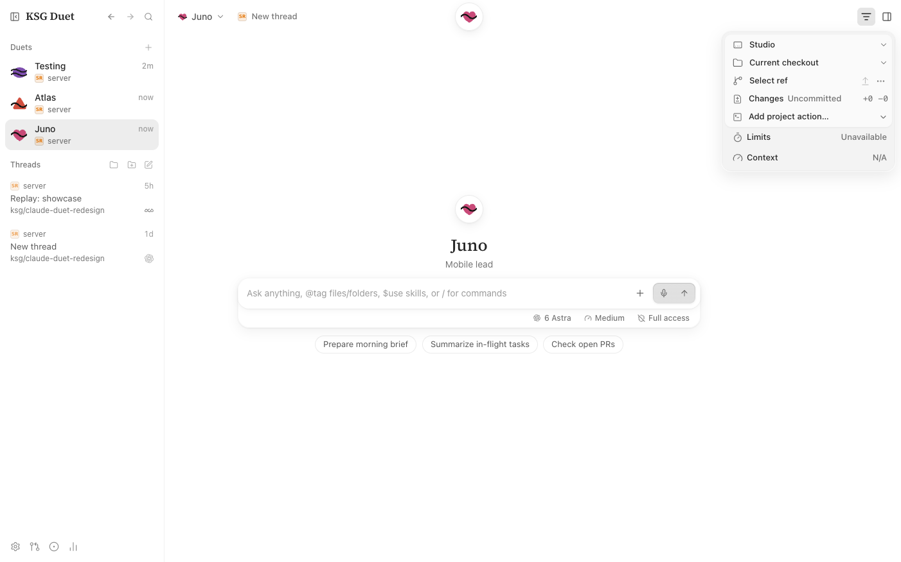
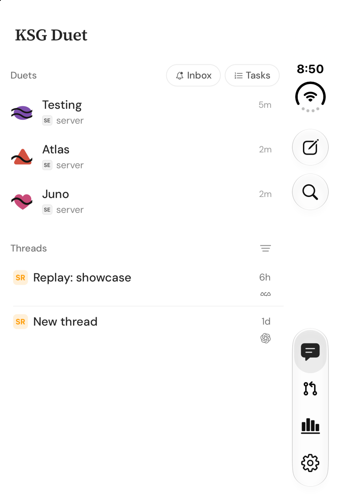
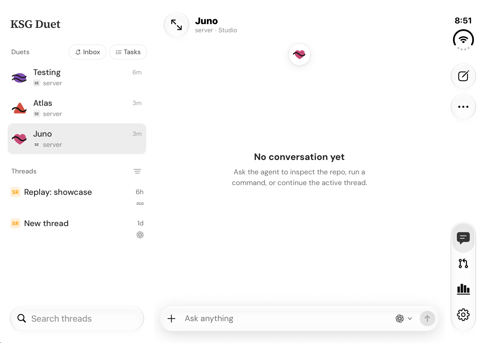

# KSG Code

KSG Code is a desktop, web, and mobile workspace for running coding agents on your own machines. It is built on [T3 Code](https://github.com/pingdotgg/t3code) and adds long-running Duet agent leads, optional long-term memory, and its own interface and release channel.



## What KSG Code adds

- **Duets.** Long-running agent leads that delegate work to crew threads across scoped projects, maintain structured documents (`NOTES.md`, `AGENTS.md`, `CREW.md`, `DIGEST.md`) and local memories, and automatically roll over long conversations when context fills up while stitching earlier conversations into the timeline.
- **Optional Honcho memory.** Off by default. When [configured on the server](./docs/user/captain-honcho-memory.md), KSG Code mirrors user messages and final Duet answers to a Honcho server and includes recalled context in briefings and memory search.
- **KSG Duet interface.** Ships with the `ksg-salon` light and dark shell as the default across desktop, web, and mobile, including adaptive split-view and reading-width layouts for foldable phones and tablets.
- **Independent release channel.** Nightly desktop builds and CLI archives publish from this repository's [GitHub Releases](https://github.com/KldsSeeGhosts/ksgcode/releases) on their own update feed, and mobile preview builds receive over-the-air updates from this fork's Expo project.

| Folded | Unfolded |
| --- | --- |
|  |  |

## What it keeps from T3 Code

- **Providers.** Drives Claude Code, Codex, Cursor, OpenCode, Grok Build, Antigravity, Kiro, Pi, Muse Code, fx, and any [ACP](./docs/user/providers-acp.md) agent using the subscriptions and logins already set up on your machine.
- **Multi-client workspace.** One Node WebSocket server backs the Electron desktop app, the web client, and the iOS and Android apps.
- **Remote access.** Connect from another computer or phone over your local network, Tailscale, or [T3 Connect](./docs/user/remote-access.md).
- **Git and worktrees.** Run threads in isolated git worktrees, review diffs, and commit, push, or open pull requests from the [source control](./docs/user/source-control.md) panel.

## Install

### Desktop and CLI

Download builds from [GitHub Releases](https://github.com/KldsSeeGhosts/ksgcode/releases):

- **macOS arm64.** `.dmg` installer. Builds are not notarized for public distribution, so first launch may require opening the app from Finder.
- **Linux x64.** `.AppImage` desktop package.
- **Windows x64.** Unsigned NSIS `.exe` installer, with the Linux CLI archive embedded for WSL.
- **CLI (`t3`).** `t3-*.tar.gz` archives with `SHA256SUMS` for macOS arm64, Linux x64, and Windows x64.

### Mobile

The iOS app is distributed as a self-signed IPA rather than through the App Store; install it by sideloading or building locally. Android and iOS source build instructions live in [apps/mobile/README.md](./apps/mobile/README.md).

### Sign in to an agent

KSG Code requires at least one coding agent installed and signed in on the host machine. See [provider setup](./docs/user/install.md#providers) for per-agent login steps.

## Development

Install [Vite+](https://viteplus.dev/guide/) (`vp`), then run from the repository root:

```sh
vp i
vp run dev
```

Use `vp run dev:desktop` for the Electron app. See the [development runbook](./docs/operations/00_development.md#first-checkout), [fork procedures](./docs/operations/ksg-fork.md), and the [documentation index](./docs/README.md) for more detail.

## Credits and license

KSG Code is built on [T3 Code](https://github.com/pingdotgg/t3code) by Ping Labs. Licensed under the [MIT License](./LICENSE).
